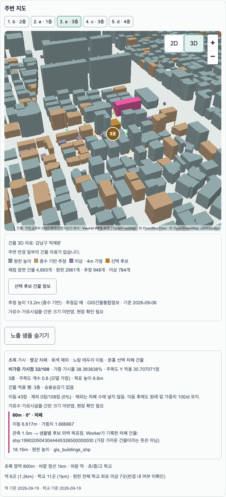
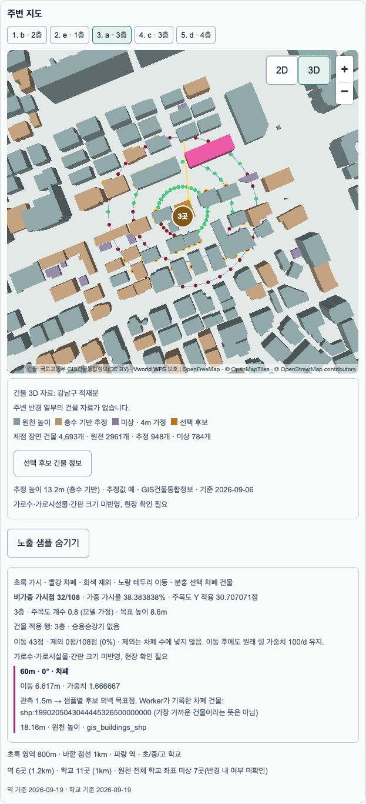

# S3-4 P2 ExposureOverlay 검증 — 2026-10-11

> 후속 상태(2026-10-12): #37 동기화 후 Preview 총점 복구·실제 GPU D5 6회·production 슬라이더를 통과했다. [최종 마감 증거](s3-4-p2-closeout-20261012.md)를 따른다. 아래 FPS 대기·총점 NULL은 10/11 당시 기록으로 보존한다.

상태: 기능·로컬 production 검증 완료, **실제 GPU FPS 대기, CI 최종 상태는 PR checks 참조, Draft 유지**. base main(#35, `1d18418`). 채점 v0.4.0·노출 모델 0.2.2와 원천 데이터는 변경하지 않았다. migration **0개**, 기존 DB 객체 변경 없음. 기존 authenticated 표시 RPC `project_exposure_geometry`만 재사용한다.

## 구현과 실제 입력

Worker가 반환한 ring SampleResult를 그대로 쓴다. 원점/이동 후 좌표/목표점·status·weight·차폐 건물 ID를 보존하며 클라이언트 표시 단계에서 샘플을 재생성하거나 레이캐스트하지 않는다. 건물과 샘플의 5186→4326 표시 RPC는 공유 직렬 큐를 쓰며, 취소된 대기 요청은 시작하지 않는다. 후보/세대/층/입력으로 구분한 화면 메모리 캐시는 최대 2개, uid 전환과 unmount 때 해제한다. 저장 데이터·ScoreResult 계약은 변경하지 않는다.

데스크톱은 3D 진입 때 오버레이를 기본으로 켜며 사용자가 끌 수 있다. 후보가 바뀌면 샘플 선택을 초기화하되 켜짐 상태는 유지한다.

MapLibre4.7.1과 deck.gl9.1.14의 MapboxOverlay interleaved(WebGL2)로 같은 canvas/depth를 사용한다. deck의 `^4.2.0` 범위에 맞는 loaders core/images/schema4.3.4를 overrides로 고정했다. 설치 시 선택된4.5.4가 미게시 worker-utils4.5.4를 요구해 설치가 실패했기 때문이다. 직접 지도 라이브러리는 승인된 deck.gl 세 패키지만 추가했다. [공식 9.1.14 MapLibre 안내](https://github.com/visgl/deck.gl/blob/v9.1.14/docs/developer-guide/base-maps/using-with-maplibre.md)를 확인했다.

## 108점·방향·양방향 연동

역삼로460 3층, 후보 좌표 `37.5025721944737, 127.05758573871447`, 목표8.6m, 눈높이1.5m. 가시 **32/108**, 가중 ratio **38.383838%**, Y0.8 적용 exposure **30.707071점**. 링별 가시점은20m **20/36**,40m **8/36**,60m **4/36**. 가중치는 이동 후 거리로 바꾸지 않고 원래 링100/d를 쓴다.

실제 브라우저 Worker 메시지와 deck layer의 전체108개 SampleResult를 대조: **불일치0**(상태·이동·목표·건물 ID 포함). 표시한324개 원점/샘플/목표 좌표를 독립 PostGIS로 역변환: 최대 오차 **2.797×10⁻⁹m**, 원래 링 반경 오차 **5.052×10⁻¹¹m**, 5186 격자 방위 오차 **1.319×10⁻¹⁰°**. 방향은 명세의 미터 격자 북쪽 기준이며 4326 화면에서 새 방위를 만들어 판정하지 않는다.

실제 deck picking으로 점 클릭→근거 열림·동일 ID 선택, 근거의 링 항목 클릭→지도 선택·Worker가 기록한 차폐 건물 feature-state 강조를 확인했다. nearest building으로 대체하지 않는다. 이동점은 원점과 연결하고 제외점은 원래 위치에 회색으로 표시한다. 제외점에는 시선·목표를 만들지 않는다. 키보드 버튼 선택도 동일 경로다.

깊이 검산은 E2E에서만 합성 cyan 점을 같은 후보XY에 추가했다. 후보 높이13.2m 위16.2m에서는 RGBA `[0,255,255,255]`, 건물 내부1.5m에서는 `[192,139,60,255]`(건물 색)로 가려졌다. 원래 레이어는 검사 후 복원한다. 초기 검사는 합성 점의 샘플 전용 접근자와 interleaved layer 등록을 바로잡는 과정이 필요했다. 이후 실제 OpenFreeMap에서 MapLibre4의 render(gl,matrix,camera)와 deck9.1의 render(gl,camera) 차이를 확인했다. 기본 near/far를 쓰면 건물 내부 점이 앞에 보였고, 실제 세 번째 camera 인자를 전달하면 위 픽셀 판정으로 바뀌었다. `alignExposureCamera`는 우리 custom layer에만 실제 카메라 인자를 전달한다. 지도 카메라·도형·레이캐스트는 바꾸지 않는다. 같은 기존 target layer를 교체해 검산하고 MapboxOverlay.setProps 경로로 복원한다. 이 호환 처리를 단위 테스트로 고정했다.

## v0.4.0·결측·모바일

- 비가중 개수, 가중 ratio, 모델 가정 Y 적용 점수를 각각 표기한다. 지하 목표2.0m/Y0.8·입구 간판 기준, 실제 적용된 R7을 설명한다.
- 승강기 미확인3층+는 보정0·신뢰도−5, 1/2/지하는 해당 표를 적용한다. 대장 pending은 기존60/−15를 설명하고 R7 적용을 주장하지 않는다. 후보 도형 미확인도 실제 사유 코드와 연결한다.
- 입력/Worker가 없으면 ‘미확인/시각화 자료 없음’으로 표시한다. 0/0이나 가짜108점을 만들지 않는다. `가로수·가로시설물·간판 크기 미반영, 현장 확인 필요` 문구를 유지한다.
- 모바일 새 BrowserContext에서는 숫자 근거·건물3D까지만 표시. 노출 버튼/오버레이 없음, deck 관련 chunk 요청 **0**. 데스크톱에서 다운로드한 뒤 viewport만 줄인 캐시를 근거로 삼지 않았다.
- 렌더 검사 중 발견한 건물/오버레이 error boundary의 중복 sibling key와 hover 잔존을 수정했다. 후보 전환·2D 복귀·off 때 draw/control/강조를 해제한다.

## 번들·지연 로딩

동일 Node22.22.0/pnpm10.7.1 production build, gzip9, 중복 chunk1회, sourcemap 제외. 브라우저 resource timeline과 production HTML을 함께 확인했다.

| 구간 | gzip bytes | 예산 |
|---|---:|---:|
| /compare 초기JS | 241386 | #32 대비+5KiB / #29 누적+10KiB |
| 초기 증가(#32 / #29) | 3843 / 6151 | 5120 / 10240 |
| 2D 지도JS / CSS | 213347 / 9949 | 358400 / 15360 |
| 건물3D 추가JS(모바일 공통) | 3191 | 51200 |
| 데스크톱 overlay/deck 추가JS | 198639 | 합산 아래 |
| 건물3D+overlay 추가JS / CSS | 201830 / 538 | 512000 / 10240 |

지도·3D·오버레이 진입 이전에는 각각 해당 동적 chunk와 표시 RPC를 요청하지 않는다. 기존 채점 exposure_inputs_v022/Worker는 숫자 채점 경로이므로 표시용 신규 요청과 구분한다. 새 env·원격 운영 스위치 변경 없음.

## 슬라이더·회귀

로컬 production build, Playwright Chromium headless/SwiftShader. 각100회×3세트, **production 정책 세트별p95≤100ms**를 적용했다. 이는 실제 GPU FPS 측정이 아니다.

| 상태 | 세트 | n | p95 ms | max ms |
|---|---:|---:|---:|---:|
| 매트릭스(3D 진입 전) | 1 | 100 | 33.900 | 76.300 |
| 매트릭스(3D 진입 전) | 2 | 100 | 33.900 | 34.400 |
| 매트릭스(3D 진입 전) | 3 | 100 | 34.000 | 34.200 |
| 오버레이 활성 | 1 | 100 | 34.300 | 34.400 |
| 오버레이 활성 | 2 | 100 | 34.200 | 34.300 |
| 오버레이 활성 | 3 | 100 | 34.100 | 34.300 |

`pnpm lint`, `pnpm typecheck`, `pnpm test` 통과(Vitest208·Python269). `E2E_APP_MODE=production SLIDER_PERFORMANCE_POLICY=production pnpm test:e2e` 1개 통과(약1.5분). 기존 a~e 점수·등록/재열기·슬라이더·지도 동기화와 모바일 경로를 함께 검사했다. 로컬 주소/지도 basemap은 기존 fixture, Supabase/RPC/Worker/deck는 실제 실행이며 원격 API 검증으로 표현하지 않는다.

## 남은 검증과 마감

- [x] Preview 실제 원격 익명 세션·주소 경로·OpenFreeMap·표시 RPC·오버레이 확인(아래 기준 분포 불일치 별도).
- [ ] D5 실제 M5 Pro GPU: 사용자 환경 설정 통보 후 AC/60Hz/저전력off 사전 확인, 승인된 뷰·건물 수·3회 측정. 평균≥55fps, 프레임간격p95≤33.4ms,50ms초과≤1%. strict slider도 다시 기록한다.
- [ ] P2 사용자 머지 후 S3-4 완료 확정. 현재 Draft 유지.

FPS harness는 필요한 frame/display trace로 범위를 좁혔다. P1에서 광범위 trace가 부분 파일로 끝난 문제를 피하기 위한 준비이며, **새 trace의 실측 성공은 아직 미확인**이다. S3-4 전체 완료를 주장하지 않는다. 이후 첫 과제는 [계획 §17](../planning/s3-4-plan.md)의 학원 점 레이어 계획이며, 실제 구현은 별도 승인 후다.

[원자료 JSON](s3-4-p2-20261011.json)에108개 샘플·좌표·슬라이더300회×2·번들 측정을 기록했다. 비밀·사용자 데이터는 포함하지 않는다.

## 원격 Preview — 실제 제품 경로

앱 코드 `ca6453b`의 [Preview](https://gilmok-6zynwqbf5-vineyard.vercel.app)에서 새 익명 세션으로 역삼로460 3층을 등록했다. Juso 검색·Vworld 좌표 Route Handler 모두200, 실행 리전icn1. 실제 원격 `score_inputs`·`exposure_inputs_v022`·`score_reference_percentiles`·`compare_map_context`·표시 변환2회 모두200. 테스트 uid는 완료/실패 모두 정리했으며 토큰·uid는 증거 파일에서 제외했다.

기본-on 3D, 건물4693개·높이3분류, 가시32/108·가중38.383838%·Y30.707071, 실제 점 picking→근거, 근거→차폐 건물, 건물 위/내부 점 깊이,2D 복귀·카메라 보존, 브라우저 예외0을 확인했다. Preview는1후보이므로 승인된 **5후보 슬라이더 벤치마크로 사용하지 않았다**. 그 벤치마크는 저장소 production E2E와 D5에서 실행한다.

### 별도 운영 발견: 원격 기준 분포 미갱신

원격 a의 현재 총점은 **NULL**, 신뢰도30이다. 수요·유동·교통 결측, cluster97.53·exposure30.71·building85·environment93.40, 임대료 미입력이다. 표시 변경으로 점수가 바뀌었다고 해석하지 않는다. 원시 수요9267.137532·유동103464.094761은 존재하고 RPC 백분위도 숫자를 반환하지만, `lib/scoring/percentile.ts`의 기존 원천 메타데이터 일치 검사가 이를 무효화한다.

원천은2026-10-10 갱신되었는데 기준 분포 snapshot은 **20260923T111436Z**다. 실제800/1000m 입력·reference 응답을 독립 비교한 첫 불일치 사유:

- `demand`: `reference_source_mismatch:resident_population`
- `flow`: `reference_source_mismatch:living_population`
- `transit.nearest_subway_m`: `reference_source_mismatch:subway_positions`
- `transit.subway_boardings_golden`: `reference_source_mismatch:subway_positions`
- `transit.bus_stops`: `reference_source_mismatch:bus_positions`

원천/기준 메타데이터 차이는 JSON에 기록했다. P1 Preview(2026-10-10 원천 갱신 전 검증)는83.102017점이었다. 이번 PR은 원격 원천·기준 분포·채점 정책을 수정하지 않는다. 기준 분포 갱신 경로 확인·복구는 별도 운영 과제로 남긴다. NULL 상태의 동일성만으로 원격 점수 회귀 통과를 주장하지 않으며, 고정 S2 fixture의 a~e 회귀는 로컬에서 별도로 통과했다.

## CI와 3D 성능 환경의 구분

초기 추가 overlay 성능 gate는 Linux SwiftShader에서 세트p95 **166.7/166.5/149.9ms**, max192.3ms로 실패했다([run](https://github.com/hanbeulYou/Gilmok/actions/runs/38136642047)). 300회 동안 MapLibre render는 **0회**였다. 가중치 반복 중 레이캐스트/좌표 RPC/지도 redraw가 병목이라는 증거는 없으며, 소프트웨어 WebGL 환경의 rAF 비용을 실제GPU 성능으로 해석하지 않는다. 마커 재생성 가설은 주원인으로 입증되지 않아 제품 변경하지 않았다.

기존 매트릭스 **CI100회×3세트, p95 중앙값≤100ms gate는 그대로**다. 새 overlay 측정은 CI에서 `software_webgl_diagnostic`으로 세트/max를 모두 보고하고, production에서는 각세트p95≤100ms를 계속 강제한다. D5의 실제GPU FPS와 overlay strict slider는 사용자 환경 설정 통보 후 수행한다. CI의 기능/picking/depth/108점/모바일/숫자 검사는 생략하지 않는다.

추가로 [CI run38137068448](https://github.com/hanbeulYou/Gilmok/actions/runs/38137068448)은3D 종료 후2D 매트릭스에서p95 200/200/199.9ms로 실패했다. 같은 구간의 로컬 production p95는34.0/34.0/34.1ms였다. 어느 브라우저/CPU/compositor 경로가 지연의 주원인인지는 확정하지 않았다. 최종 테스트는 **기존 매트릭스 회귀를3D 초기화 전 동일5후보·지도 idle 상태에서 측정**하고 `phase=matrix_before_3d`를 남긴다. 기준/표본 수/계산법은 그대로다. 이어서108점·양방향·차폐·3D 활성 슬라이더·모바일·저장/재열기를 검증한다. production overlay 기준은 각세트100ms이며 실제GPU 검증은 여전히 미완료다. CI의3D 이후 비용을 제품 최소사양 보장으로 해석하지 않고 공개 전 일반 노트북 확인을 유지한다.

최종 CI 상태/로그/각세트·max는 [PR #36 checks](https://github.com/hanbeulYou/Gilmok/pull/36/checks)와 PR 설명의 검증 실행 링크를 따른다. 위 실패 실행도 보존하며 검사 범위·측정 시점 변경을 숨기지 않는다.
